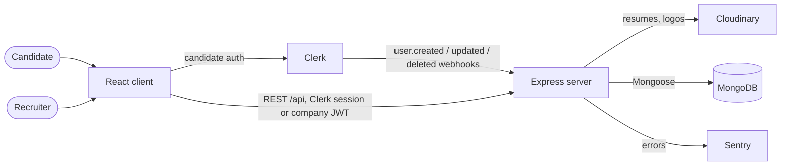

# HireMe: High-Level Design

A full-stack job portal: candidates browse and apply for jobs with their resume; recruiters (companies) post jobs, manage visibility and review applicants. Live at [hireeme.vercel.app](https://hireeme.vercel.app). For code-level detail see the [Low-Level Design](lld.md).

## 1. Context

## 2. Two kinds of users

| User | Sign-in | Can |
|---|---|---|
| Candidate | Clerk (synced into MongoDB by webhook) | Search jobs, apply, upload a resume, track applications |
| Recruiter (company) | Email + password, JWT valid 30 days | Post jobs, show / hide jobs, view applicants, accept or reject |

## 3. Components

| Part | Responsibility |
|---|---|
| Client pages | Home (search and filters), Apply Job, Applications; recruiter Dashboard with Add Job, Manage Jobs, View Applications |
| `/api/jobs` | Public job list and details |
| `/api/users` | Candidate data, apply, applications, resume upload |
| `/api/company` | Recruiter register / login and recruiter features |
| `/webhooks` | Verifies Clerk events with Svix and keeps the User collection in sync |

## 4. Tech

| Layer | Choice |
|---|---|
| Front end | React (Vite), React Router, Clerk React, context state |
| Back end | Node.js, Express, Mongoose, multer, Clerk Express middleware |
| Media | Cloudinary |
| Monitoring | Sentry |
| Deployment | Vercel; Docker + docker-compose (app + `mongo:7.0`) for local or self-hosted runs |
