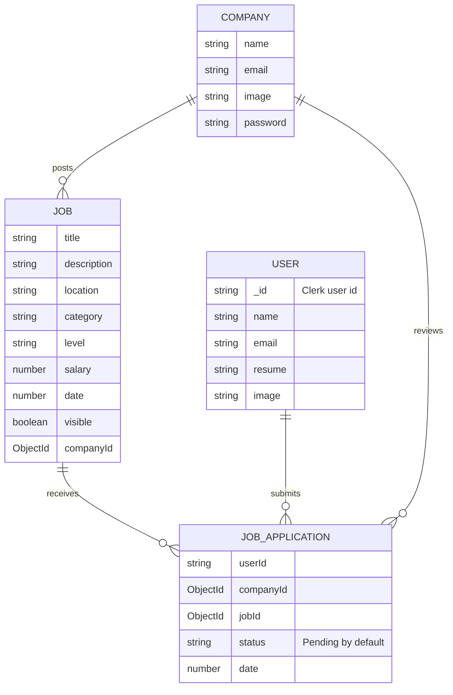
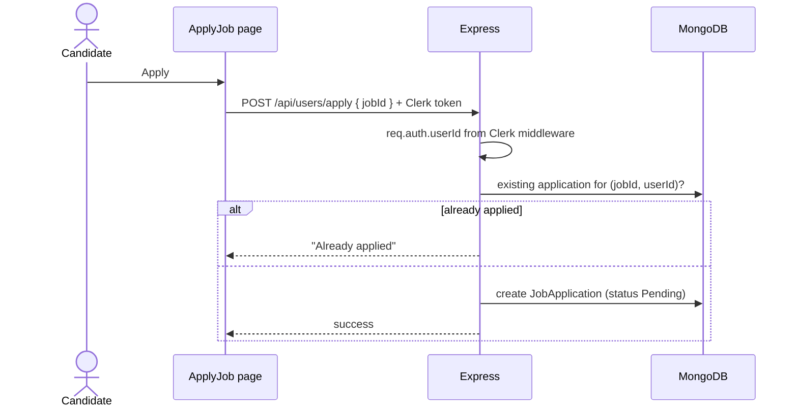

# HireMe: Low-Level Design

For the big picture see the [High-Level Design](hld.md).

## 1. Models

## 2. API

| Method | Route | Guard | Behavior |
|---|---|---|---|
| GET | `/api/jobs`, `/api/jobs/:id` | | Visible jobs and job details |
| GET | `/api/users/user` | Clerk | Candidate profile |
| POST | `/api/users/apply` | Clerk | Rejects a second application to the same job |
| GET | `/api/users/applications` | Clerk | Candidate's applications |
| POST | `/api/users/update-resume` | Clerk + multer | Uploads resume to Cloudinary |
| POST | `/api/company/register` | multer | Company with logo; password hashed; returns JWT |
| POST | `/api/company/login` | | Returns JWT (30 days) |
| GET | `/api/company/company`, `/list-jobs`, `/applicants` | company JWT | Recruiter data |
| POST | `/api/company/post-job`, `/change-status`, `/change-visiblity` | company JWT | Manage jobs and applications |
| POST | `/webhooks` | Svix signature | Clerk user sync |

## 3. Apply for a job

## 4. Clerk webhook

| Event | Action |
|---|---|
| `user.created` | Create User with Clerk id, name, email, image, empty resume |
| `user.updated` | Update name, email, image |
| `user.deleted` | Delete the User |

## 5. Notes

`/debug-sentry` deliberately throws an error to test Sentry and should be removed or protected in production.
